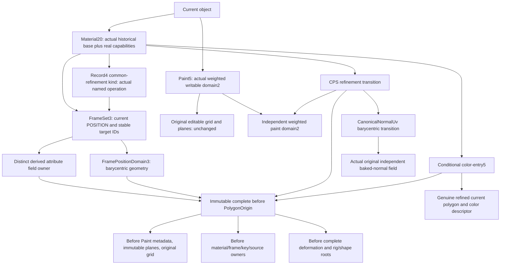

# Refined Mirror owning integration plan (proposal)

No public append or wire implementation is authorized by this document alone. The private anchor, raw-role draft and complete vertex transport proofs establish ingredients; they do not publish a Scene or complete supported native Mirror.

## Dependency graph

All strong edges point backward. A current frame/key owner must not be strongly retained by its before anchor. POSITION endpoint arrays and current stable IDs remain owned once by current FrameSet, not copied into a competing attribute authority. Derived field validation receives that actual frame/model context and recomputes expected N/T fields and operation lineage; expected-owner/controlblock checks always run. A private runtime lease may be reminted only after full owning decoder replay.

Strict unit NormalFrames remain actual raw/source owners. Raw4 does not become derived36. Refined raw role values, new target offsets and real barycentric provenance live in the distinct field owner. Old source IDs, uv_origin, role UV coordinates, artist N/T/handedness, original targets and first shape/rig roots remain unchanged. Normal-free generic keys must be representable without inventing a normal preparation.

## Conditional formats and reader order

The proposed genuine refinement capability is Scene38/material20. Historical record4 explicit-plane relative Mirror remains byte-identical. A new common-refinement record4 kind must carry explicit kind/provenance and fail in old record4 readers. FramePosition record3 and FrameSet/FrameArchive3 are owning contexts; standalone legacy NormalFrames unit validation remains unchanged.

Paint5/domain2 owns actual weighted paint correspondence. It must not reinterpret domain1 integer source corners, native Source4, or CPS37 integer maps. CanonicalNormalUv needs an explicit barycentric variant retaining the actual separate normal field and its own coordinate association. Conditional color-entry5 is needed because color-entry4 SourceColorUvLayout has only integer source vertices. Inspection of current material-bindings.cpp shows color entries1..4 only; verify against the final coordinated union again before implementation. Existing paired normal-entry6 already denotes explicit key Mirror and must refer to the genuine new key kind; it cannot independently grant refinement authority.

Material20 must retain the actual historical base1..10 and independently authenticated physical, canonical-normal, native32, native36, CPS37 and refinement flags/pools. Outer38 alone admits nothing. Decode bounded structural shapes and quotas first, then already defined before materials/paints/models/origins, geometry and sampling leaves, attribute fields/current frames, key/current binding, and finally all current Scene associations. No provisional object is published. Before-root references must be strictly backward/acyclic, and every new pool must be reachable. Equal-valued meshes/fields do not prove alias ownership.

No-feature writers must preserve old Paint1..4/domain1, frame1/2, materials1..19 and existing Scene bytes. Actual new metadata must cause old/standalone readers to reject before allocation. Mixed35/36/37 actors and all retained rig/shape/source histories require real pool capabilities and recursive min-version/resource closure; no numeric max-version admission.

## Vertex, paint and query invariants

The native packet must retain complete evaluated before vertex outputs before barycentric interpolation: world position, geometric n, selected source N/T/B and W, and independent canonical N/T/B. Normalizing inserted raw role values or recomputing B from interpolated N/T is incorrect. Actual before pose/morph/object/group/full-affine placement and held transforms remain authoritative.

Source UV0..7, current authored UV0, role UVs, writable paint coordinates, normal field coordinates, source RGBA and cut position remain independent logical-corner fields. Packed reflected EBO ordering uses the existing explicit paint_winding_reversed flag. No renderer inference from posed geometry or equal stream lengths is allowed. CPU picking must evaluate the same actual geometry and coordinate owners without GPU readback.

A proposed new-derived-target policy is the original complete before-VS field plus a declared difference F(base + new offsets) - F(base), with independent B and geometric handling. This policy is not yet implemented or qualified. Zero new keys must remain exactly zero in geometry and every field, and simultaneous old/new weights, Replace, Duplicate, CaptureMix and Mirror must retain their declared endpoint semantics. Exact dynamic skin and later independent derived weights need genuine before-evaluated geometry/field transport; averaging raw source weights is invalid.

The worker can prepare an immutable transient AttributePreviewPacket containing actual source-corner data and current owner/model leases. A single RGBA32F texture buffer can hold original columns plus exact stencil indices/weights and correction data, using gl_VertexID and existing attributes. A SurfaceRange transient pointer is likely required; ObjectSurface can use its existing material/deformation context unless a measured cache requires another append. Before committing this interface, verify actual vertex/fragment/combined texture-unit limits and all packet/output/upload budgets. Preserve the old no-owner shader path,16-attribute floor and second-eye reuse. The private prototypes currently prove243 source/canonical and324 extended geometric lighting views, not the complete production fragment pipeline.

Typed V1 require_vrm1_authored_normal_frame must explicitly refuse attribute_sampling until its authentic adapter exists; OriginalAttributes/equal PBR/MToon arrays no longer suffice. Existing compiler/bake/cut/native/export guards remain until each paired consumer has an adapter.

## Native and portable gates

First publish the genuinely reflectable canonical/F32 square through actual Document Mirror, immutable before capture, current fields and exact paint grid, Undo/Redo, Cancel/queued Save, Save/reopen and layered Restore. Preserve the original five-vertex missing-reflected-coverage counterexample as refusal; refinement cannot create absent surface coverage. Then exercise further source/humanoid planes and general real models without nearest/projection/tolerance substitutions.

Standard GLB cannot generally encode independent raw before-VS interpolation merely by normalizing inserted N/T. A measured portable normal/material adapter is required, with exact native project authority and truthful finite-view descriptors where approximation is unavoidable. Ordinary strict export and typed V1 remain guarded until real adapters pass independent posed consumers. Physical package4 names CPS37; refinement must obtain a coordinated explicit domain/package capability, not disguise itself as native32/CPS37. Versions1..4 bytes and semantics remain exact. No new emission package number is reserved by this proposal.

## Matching builds and storage

No previous archives may be linked against appended FrameSet/SurfaceRange or changed PaintSamplingDomain/SourceColorPaintSampling layouts. Build all owning core/support/render/native frontend/XR units afresh in each profile before running any new consumer. Every test executable in the cohort must use those exact headers/libraries. Final broader integration still needs fresh optimized alltargets/full regression; selected sanitizer scope does not substitute for it.

Measured closed package4-bf sanitizer build for app plus five consumers retained0.930GiB of11 archives and2.071GiB of6 executables; pre-cleanup compiler objects were1.030GiB logical. Thus the actual six-target footprint was about4.03GiB, excluding test outputs. A planned app plus up to12 focused owning/codec/render/export/legacy consumers is forecast at7GiB sanitizer plus1.5GiB optimized. Reserve12GiB total including CMake/generated files, separate profile artifacts and bounded proof outputs. Use selected required targets, not every old sanitizer executable; all units reachable by those targets remain fresh/coherent. Compiler concurrency stays -j2/nice15 initially. Archive snapshots use reflink only.

Before build: coordinator must reserve12GiB and retain at least20GiB outside it for root/live proof work; verify actual free bytes and projected outputs. Stage app/core/support plus direct factory/codec targets first and record actual extent growth before extending the frozen target set. If the estimate is exceeded, stop scheduling new phases at a terminal boundary and reassess; do not delete live inputs or silently borrow old ABI archives. Authorized cleanup has already removed only853 unreferenced closed .o files with exact hashes, retaining26 protected .o and every binary/archive/source/receipt. Root's older closed .o candidates are an additional coordinator decision, not an assumed budget.
