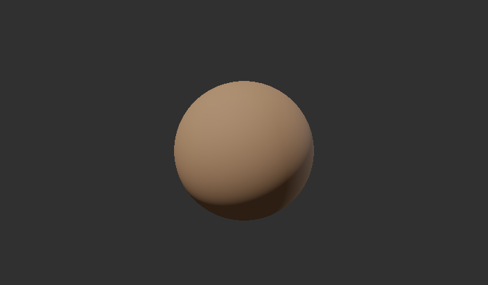

# Complete090f native Wayland GPU runtime — 2026-11-17

The complete optimized090f application passes all14 actual native Wayland
checks through current canonical DomeD. This adds real compositor/menu/native
Wayland evidence to the prior [whole Release build](NATIVE90-RELEASE-OWNING-20261117.md)
and [public desktop/stereo results](WHOLE090F-PUBLIC-UI64-XR260-20261117.md).
The application is the fresh whole-build9143ea59 executable, without product
source or runtime overlays.

The compositor is canonical DomeD`acc2b70a`, built as the regular user with
`cargo build --offline --locked --release`, two jobs, the current canonical
FLTK SDK and private bitmap runtime. Cargo's main-artifact record is optimized
and freshly built; dependency fingerprints may be reused. This is not a
fresh-all-crates claim. All1037 source pins remain unchanged before/after and
at sealing. Two staged compositor copies are independent files with identical
378309b9 bytes; no binary is committed in this evidence capsule.

The actual application GL context uses Intel Arc A770, PCI03:00.0,
renderD129/i915, with live matching DRM descriptors. Canonical FLTK/FreeType/
HarfBuzz/Cairo mapped libraries are retained. DomeD reports Arc Zink/Vulkan
composition, and the client viewport visibly presents the default clay surface.
The14 checks cover the existing eight menu/dialog/text/desktop-side controls,
actual GPU/context/canvas controls, global Undo and ordinary close/teardown.

This is a native Wayland application in a nested diagnostic compositor hosted
on private Xvfb. Diagnostic presentation includes a copy. It does not prove
native DRM zero-copy/scanout or physical-headset operation. No active session
was restarted and nothing was installed.

Failures remain separate: v1 lacked the staged compositor, v2 selected the old
Xvfb dependency path, and v3's observer was never called because the desktop
canvas does not query GL_RENDERER. V4 forwards the standard EGL make-current
call unchanged, then triggers the original strict pure GL query after success.
The observer creates no context and changes no drawing or product behavior.
It is one complete test-only TU with a genuineMD record and302 dependencies;
only its own source is a project dependency, with no private product headers.

The driver exits0 with14/14 checks and zero input drift. Root captured successful
unit properties/journal for Main2547653/Invocation6152d98f before stopping that
completed unit. It was already absent when sealing began; no unit was recreated
or stopped by the sealing agent. All recorded owned same-start children are gone.
The completed run released its lease; the next slot was explicitly handed on.

[Machine receipt and compact runtime archive](validation/WHOLE090F-WAYLAND-GPU-ACTUAL-20261117.json)
retain code/derivations, exactMD and ELF hashes, captures/maps/device records,
actual terminal outputs and every failed prefix. No whole-SAN, performance or
full-production completion claim follows from this milestone.

